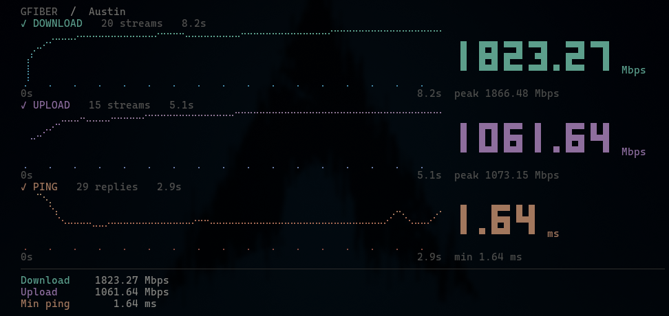

# gfiber-speed



## Build

With Go 1.22 or later installed, build the CLI from the repository root.

```sh
make build
```

You can also build it directly with `go build -o gfiber-speed .`.

## Usage

Run the Google Fiber speed test with automatic server selection.

```sh
./gfiber-speed
```

| Command | What it does |
| --- | --- |
| `./gfiber-speed --list-servers` | Lists available servers and their region IDs. |
| `./gfiber-speed --server aus` | Runs the test against Austin. |
| `./gfiber-speed --plain` | Prints results without animation. |
| `./gfiber-speed --server aus --json` | Writes the Austin results to stdout as JSON. |

Press Ctrl-C to stop a running test.
